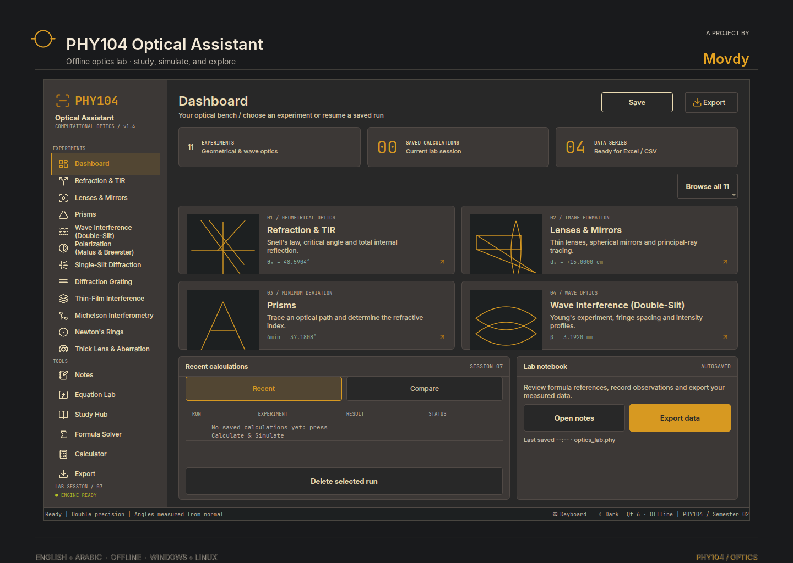
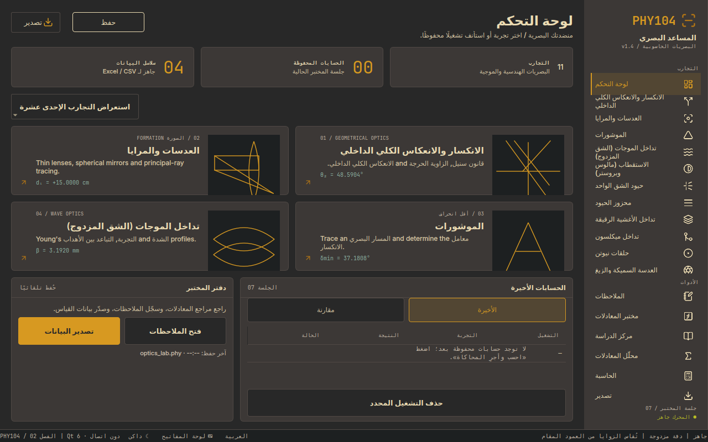
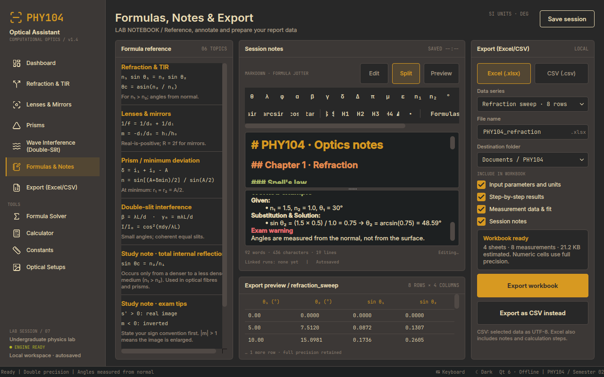
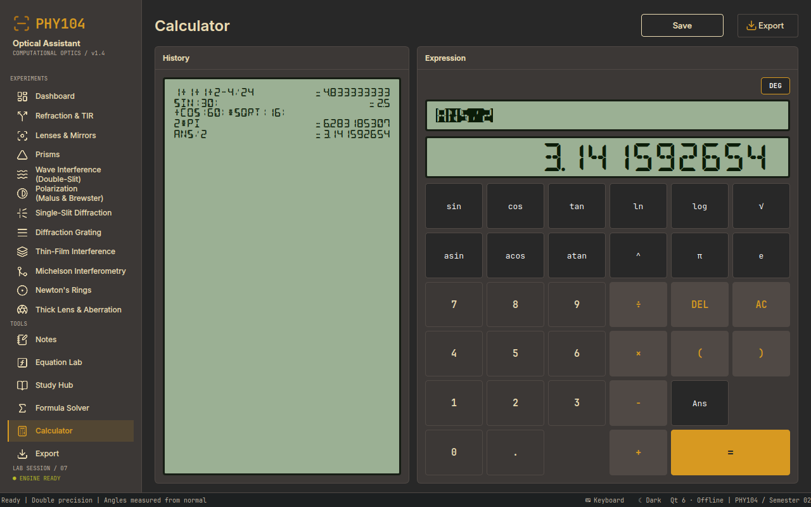

# physics Optical Assistant

**An offline optics lab and study companion for PHY104.** Built with C++20 and Qt 6 for Windows and Linux. The app needs no AI service, account, database, or internet connection.


## عن المشروع

<div dir="rtl" align="right">
<p>مشروع <strong>فيزياء 104</strong> أعدّه <strong>Movdy2</strong> بمساهمة <strong>أحمد سمير</strong> لمقرر فيزياء 104 في جامعة زويل للعلوم والتكنولوجيا، بإشراف علمي ومراجعة من الدكتور أشرف، مدرّس المقرر.</p>

<p>يهدف البرنامج إلى مساعدة الطلاب والمدرّسين وأعضاء هيئة التدريس على تطبيق قوانين المقرر واستكشاف تجاربه. وهو بيئة تعليمية متكاملة، لا مجرد أداة واحدة، ويضم:</p>

<ul>
<li><strong>محلّل المعادلات (Formula Solver):</strong> يضم قوانين المقرر ويساعد على حل المسائل بإدخال المعطيات والتعويض بها.</li>
<li><strong>11 تجربة فيزيائية</strong> مستمدة من المقرر.</li>
<li>أدوات لتدوين الملاحظات والعمل على المسائل، وملخصات أُعدّت يدويًا للمراجعة.</li>
</ul>

<p>أُعدّ التصميم باستخدام <strong>Figma AI</strong>، واستُعين بأدوات الذكاء الاصطناعي لتسريع التطوير والمساعدة في معالجة بعض المشكلات. وقد بُذل جهد كبير في إنجاز المشروع، مع بقاء التطبيق نفسه قابلًا للاستخدام دون اتصال بالإنترنت أو خدمات ذكاء اصطناعي.</p>

<p><strong>إهداء إلى 🦤🧢</strong></p>
</div>


[](https://github.com/movdy2/phy104-sim/actions/workflows/build.yml)
[](https://github.com/movdy2/phy104-sim/releases/latest)



## Download v2.3.0

| Platform | Download |
|---|---|
| **Windows x64 installer** | [PHY104 Optical Assistant Setup](https://github.com/movdy2/phy104-sim/releases/download/2.9/PHY104OpticalAssistant-2.9.0-Windows-x64-Setup.exe) |
| **Windows x64 portable** | [Portable ZIP](https://github.com/movdy2/phy104-sim/releases/download/2.9/PHY104OpticalAssistant-2.9.0-Windows-x64-portable.zip) |
| **Linux x86_64** | [AppImage](https://github.com/movdy2/phy104-sim/releases/download/2.9/PHY104OpticalAssistant-2.9.0-Linux-x86_64.AppImage) |

See the [v2.3.0 release page](https://github.com/movdy2/phy104-sim/releases/tag/v2.3.0) for all files and release notes.

### Installation

- **Windows installer:** download and run the Setup `.exe`.
- **Windows portable:** extract the ZIP, then run `PHY104OpticalAssistant.exe` from the extracted folder. The ZIP includes the Qt runtime and application data; the executable should not be separated from those files.
- **Linux:** download the AppImage, make it executable, and run it:

  ```sh
  chmod +x PHY104OpticalAssistant-2.3.0-Linux-x86_64.AppImage
  ./PHY104OpticalAssistant-2.3.0-Linux-x86_64.AppImage
  ```

  The AppImage is smoke-tested on Arch Linux. For normal AppImage mounting on Arch, install FUSE 2 and the runtime libraries if needed:

  ```sh
  sudo pacman -S --needed fuse2 gcc-libs harfbuzz libglvnd fontconfig freetype2 libxkbcommon
  ```

## Features

- **11 interactive optics experiments:** refraction and total internal reflection, lenses and mirrors, prisms, double-slit interference, polarization, single-slit diffraction, diffraction gratings, thin films, Michelson interferometry, Newton's rings, and thick lenses with aberration.
- **Study tools:** Markdown notes with live LaTeX preview and a scientific keyboard; Equation Lab; a chapter-based Study Hub; a 42-formula solver; and a scientific calculator.
- **Save and export:** calculations and notes save locally. Export measurements to CSV or Excel-compatible `.xls`, or create and print a PDF lab report.
- **English and Arabic:** switch languages in the app, with right-to-left Arabic layout and bundled Arabic-capable fonts. Equations and numeric entry remain left-to-right.
- **Dark and light themes:** explore interactive ray diagrams, plots, and resizable experiment pages in either theme.

See the [Figma-to-code mapping](docs/FIGMA_MAPPING.md) for screen-by-screen design notes.

## Screenshots

| Arabic dashboard · RTL | Refraction and total internal reflection |
|---|---|
|  |  |

| Notes workspace | Scientific calculator |
|---|---|
|  |  |

More captures are in [`docs/screenshots/`](docs/screenshots/).

## Build from source

### Requirements

- CMake 3.21 or newer
- A C++20 compiler
- Qt 6 with **Widgets**, **Svg**, and **PrintSupport**
- Ninja (recommended)

On Ubuntu, install the build dependencies with:

```sh
sudo apt-get install build-essential cmake ninja-build qt6-base-dev qt6-svg-dev libgl1-mesa-dev libegl1-mesa-dev
```

### Build and test

```sh
cmake -S . -B build -G Ninja -DCMAKE_BUILD_TYPE=Release
cmake --build build --parallel
ctest --test-dir build --output-on-failure
./build/src/PHY104OpticalAssistant
```

For a Windows build, configure CMake with a Qt 6 MSVC installation, for example `-DCMAKE_PREFIX_PATH=C:/Qt/6.8.3/msvc2022_64`. To build and test only the Qt-free core, configure with `-DPHY104_BUILD_GUI=OFF`.

To capture screenshots after building, run:

```sh
./build/src/PHY104OpticalAssistant --screenshots build/screenshots
```

Linux and Windows Qt builds and the core-only tests run in GitHub Actions.

## Project layout

- `src/ui/` — Qt application, pages, diagrams, plots, themes, and language handling
- `src/core/` — physics, calculations, reports, and export logic
- `src/data/` — JSON repositories and session persistence
- `data/` — built-in study and experiment data
- `assets/` — translations, diagrams, bundled fonts, and icons
- `tests/` — core, data, UI, and interaction tests

The built-in formulas, constants, chapters, keyboard definitions, and optics presets are in `data/`. Session files are stored locally in the application's `.phy` format. Font and icon notices are in [`assets/fonts/LICENSES.txt`](assets/fonts/LICENSES.txt) and alongside the bundled Noto Sans Arabic font.

## Project credits

Created for the PHY104 course at Zewail University of Science and Technology by [**Movdy2**](https://github.com/movdy2), with a contribution from **Ahmed Samir**. Scientific supervision and review were provided by **Dr. Ashraf**, the course instructor.

The interface design was prepared with Figma AI. AI tools also helped speed up development and troubleshoot issues; the app itself runs locally and does not depend on an AI service.

#zewail-city
