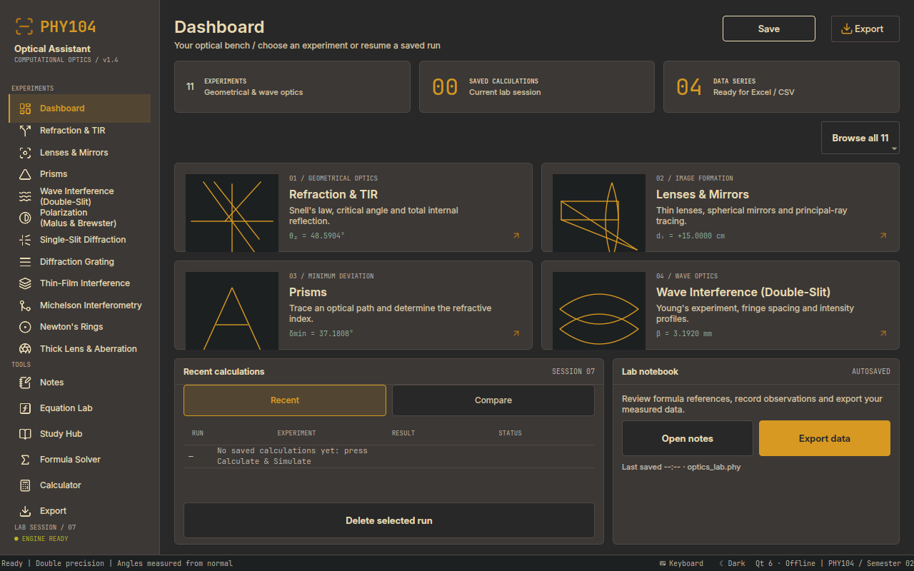
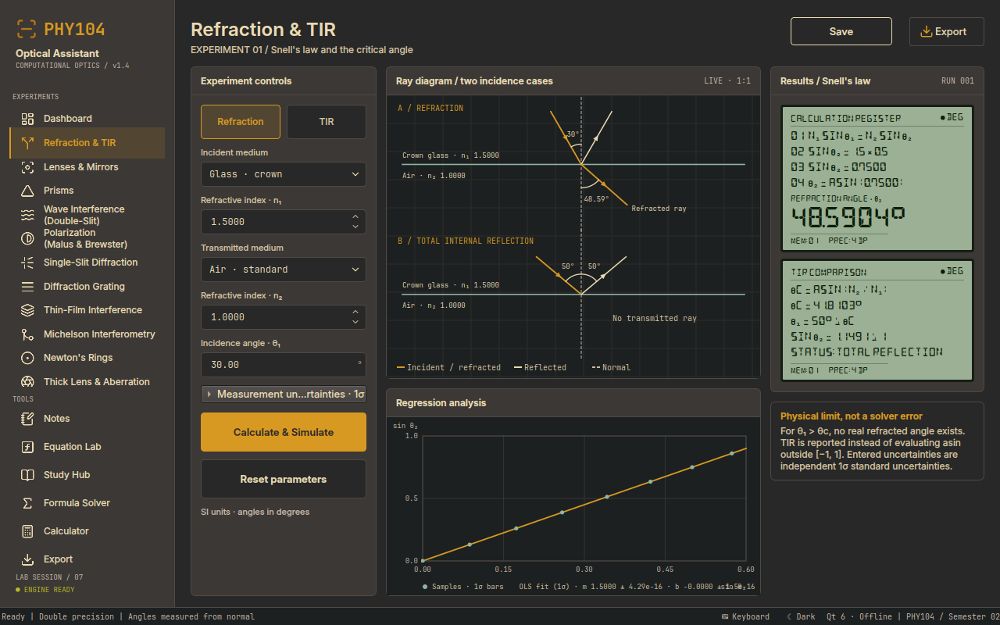
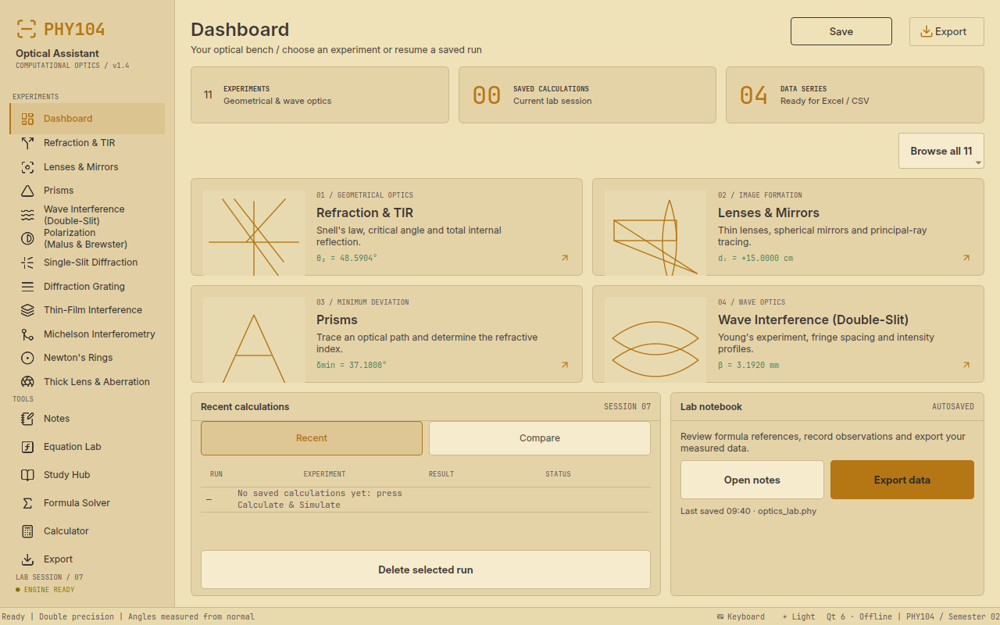

# PHY104 Optical Assistant

[](https://github.com/movdy2/phy104-sim/actions/workflows/build.yml)

An offline desktop lab notebook and optics simulator for PHY104. Built with C++20 and Qt 6 for Windows and Linux. It includes an English/Arabic interface, right-to-left Arabic layout, and bundled Arabic-capable fonts. No account, database, or network connection is required.

## Screenshots

| English dashboard | Arabic dashboard · RTL |
|---|---|
|  |  |

| Refraction and total internal reflection | Notes workspace |
|---|---|
|  |  |

| Calculator | Light theme |
|---|---|
|  |  |

More captures are in [`docs/screenshots/`](docs/screenshots/).

## Features

- **11 interactive optics experiments:** refraction/TIR, lenses and mirrors, prisms, double-slit interference, polarization, single-slit diffraction, diffraction grating, thin films, Michelson interferometry, Newton's rings, and thick lenses/aberration.
- **Study tools:** Markdown Notes with live LaTeX preview and an in-page scientific keyboard; Equation Lab; Study Hub with chapter material and separate personal notes; a 42-formula solver; and a scientific calculator.
- **Save and export:** calculations and session notes autosave locally. Export measurement data to CSV or Excel-compatible `.xls`, or create and print a PDF lab report.
- **English and Arabic:** the interface switches language at runtime. Arabic uses a bundled Noto Sans Arabic font and RTL layout; equations and numeric entry stay left-to-right. User-authored notes are not rewritten when changing language.
- **Themes and diagrams:** dark/light themes, interactive diagrams and plots, and resizable application pages.

See [the Figma-to-code mapping](docs/FIGMA_MAPPING.md) for the screen-by-screen design notes.

## Downloads

A version tag (`v*`) builds and publishes these GitHub Release assets:

- **Linux x86_64:** a single `.AppImage` file.
- **Windows x64:** a setup `.exe` installer and a portable `.zip` containing the app `.exe`, Qt runtime, and `data/` files. A bare `.exe` by itself is not sufficient to run the Qt application.

After the packaging workflow is merged, publish a release by tagging a merged commit, for example:

```sh
git tag v2.3.0
git push origin v2.3.0
```

Pull requests and manual workflow runs also build downloadable test artifacts in the Actions run; those are not published as GitHub Releases.

## Build and run

Requirements: CMake 3.21+, a C++20 compiler, and Qt 6 with **Widgets**, **Svg**, and **PrintSupport**. The fonts and icons are bundled in `assets/`.

```sh
cmake -S . -B build -G Ninja -DCMAKE_BUILD_TYPE=Release
cmake --build build --parallel
ctest --test-dir build --output-on-failure
./build/src/PHY104OpticalAssistant
```

On Ubuntu, install the build dependencies with:

```sh
sudo apt-get install build-essential cmake ninja-build qt6-base-dev qt6-svg-dev libgl1-mesa-dev libegl1-mesa-dev
```

For Windows, configure CMake with the path to your Qt 6 MSVC installation, for example `-DCMAKE_PREFIX_PATH=C:/Qt/6.8.3/msvc2022_64`. To build and test only the Qt-free core, configure with `-DPHY104_BUILD_GUI=OFF`.

The Linux and Windows Qt builds and the core-only tests run in GitHub Actions on pull requests. To capture screenshots locally after building, run:

```sh
./build/src/PHY104OpticalAssistant --screenshots build/screenshots
```

## Data and project layout

The built-in formulas, variables, constants, chapters, keyboard definitions, and optics presets live in `data/` as JSON. Add formulas in `data/formulas.json` and make sure their variables exist in `data/variables.json`; the test suite checks the real data set. Session files are stored locally in the application's `.phy` format.

- `src/ui/` — Qt application, pages, diagrams, plots, themes, and language handling
- `src/core/` — physics, calculation, reporting, and export logic (no Qt dependency)
- `src/data/` — JSON repositories and session persistence
- `data/` — built-in study and experiment data
- `assets/` — Qt resources, translations, diagrams, fonts, and icons
- `tests/` — core, data, UI, and interaction tests

Font and icon notices are in [`assets/fonts/LICENSES.txt`](assets/fonts/LICENSES.txt) and alongside the bundled Noto Sans Arabic font.
